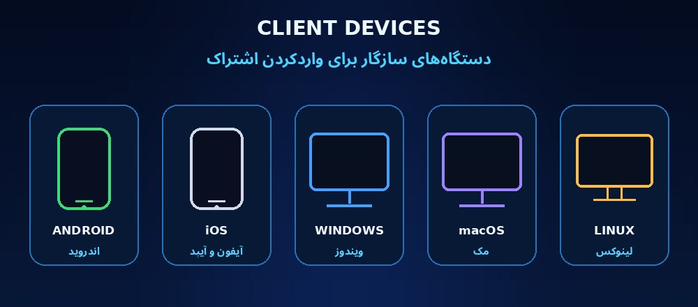

<div align="center">
  
  <h1>𝑭𝒊𝒏𝒆𝑽𝑷𝑵</h1>
  <p><strong>پنل حرفه‌ای مدیریت اشتراک و سرویس‌های VLESS</strong></p>
  <p>Secure · Lightweight · Dark Glass UI · فارسی / English</p>
  <p>
    
    
    
    
    
  </p>
  <p>
    <a href="#شروع-سریع">🚀 شروع سریع</a> &nbsp;·&nbsp;
    <a href="#راهنمای-پلتفرمها">☁️ پلتفرم‌ها</a> &nbsp;·&nbsp;
    <a href="#دانلود-کلاینتها">📲 دانلود کلاینت‌ها</a> &nbsp;·&nbsp;
    <a href="SECURITY.md">🛡️ امنیت</a> &nbsp;·&nbsp;
    <a href="https://t.me/sadiq_AFG1">💬 پشتیبانی</a>
  </p>
</div>

---

## ✨ نمای کلی پروژه

**𝑭𝒊𝒏𝒆𝑽𝑷𝑵** یک پنل سبک مبتنی بر FastAPI برای مدیریت گروه‌های اشتراک و لینک‌های VLESS است. رابط کاربری فارسی و انگلیسی، پنل مدیریت، پرتال اشتراک، تم تاریک ثابت، کنترل سهمیه و انقضا و ابزارهای پایش را در یک بسته ارائه می‌کند.

<div align="center">
  <table>
    <tr>
      <td align="center" width="50%"><strong>پنل مدیریت</strong><br/></td>
      <td align="center" width="50%"><strong>پنل ساب / پرتال اشتراک</strong><br/></td>
    </tr>
  </table>
</div>

> تصاویر بالا پیش‌نمایش رابط با داده‌های نمونه هستند. اطلاعات واقعی مصرف، سهمیه، سرور و اتصال فقط از داده‌ها و شمارنده‌های موجود در نصب اجراشده خوانده می‌شوند؛ پیش‌نمایش، وضعیت زندهٔ سرور را نشان نمی‌دهد.

## ☁️ راهنمای پلتفرم‌ها

<div align="center">
  <a href="DEPLOY_AWS_EC2.md"></a>
  <a href="DEPLOY_VPS.md"></a>
  <a href="DEPLOY_RENDER.md"></a>
  <a href="DEPLOY_RAILWAY.md"></a>
  <a href="DEPLOY_CLOUDFLARE.md"></a>
  <a href="https://shiprr.app/" title="Shiprr official wordmark"><strong>shiprr.</strong></a>&nbsp;<a href="DEPLOY_SHIPRR.md" title="Shiprr.app deployment guide"></a>
  <a href="DEPLOY_SHARED_HOSTING.md"></a>
</div>

| پلتفرم | کاربرد و محدودیت | راهنمای مستقل |
|---|---|---|
| **AWS EC2** | اجرای کامل روی ماشین مجازی با دسترسی سیستم‌عامل و شبکه | [راهنمای AWS](DEPLOY_AWS_EC2.md) |
| **VPS / Dedicated** | گزینهٔ پیشنهادی برای پنل و سرویس تونل کامل | [راهنمای VPS](DEPLOY_VPS.md) |
| **Render** | اجرای پنل FastAPI و مسیرهای وب؛ برای دادهٔ پایدار باید Disk متصل شود | [راهنمای Render](DEPLOY_RENDER.md) |
| **Railway** | اجرای پنل؛ برای state محلی از Volume استفاده شود | [راهنمای Railway](DEPLOY_RAILWAY.md) |
| **Cloudflare** | DNS، پروکسی یا Tunnel در جلوی سرور اصلی؛ Workers میزبان کامل این برنامه نیست | [راهنمای Cloudflare](DEPLOY_CLOUDFLARE.md) |
| **Shiprr.app** | اجرای وب‌اپ FastAPI؛ ذخیره‌سازی ماندگار باید جداگانه پیکربندی شود | [راهنمای Shiprr](DEPLOY_SHIPRR.md) |
| **هاست اشتراکی** | فقط در صورت پشتیبانی واقعی از ASGI، WebSocket، پردازش ماندگار و شبکهٔ خروجی | [راهنمای هاست](DEPLOY_SHARED_HOSTING.md) |

**نکتهٔ سازگاری:** همهٔ پلتفرم‌ها جایگزین یکدیگر نیستند. برای اجرای کامل سرور VPN، VPS یا EC2 با دسترسی شبکه و ذخیره‌سازی پایدار توصیه می‌شود. راهنماهای هر پلتفرم سطح پشتیبانی و محدودیت‌ها را جداگانه توضیح می‌دهند؛ نمایش لوگو به‌معنی تضمین اجرای تونل کامل روی آن پلتفرم نیست.

## 🚀 شروع سریع

**نیازمندی‌ها:** Python 3.11+ یا Docker Engine و Docker Compose.

### روش Docker

```bash
cp .env.example .env
# قبل از انتشار عمومی، ADMIN_PASSWORD و SECRET_KEY اختصاصی تنظیم کنید.
docker compose up -d --build
```

### روش Python

```bash
python -m venv .venv
source .venv/bin/activate
pip install -r requirements.txt
uvicorn main:app --host 0.0.0.0 --port 8000
```

برای دسترسی عمومی، برنامه را پشت reverse proxy دارای HTTPS اجرا کنید. پورت داخلی برنامه را مستقیماً به اینترنت باز نکنید. راهنمای کامل‌تر در [INSTALL.md](INSTALL.md) قرار دارد.

## 🔐 ورود اولیه پنل

در **نصب تازه**، اگر متغیرهای اعتبارنامه مقداردهی نشده باشند و state قبلی وجود نداشته باشد:

| فیلد | مقدار پیش‌فرض |
|---|---|
| نام کاربری | `Admin` |
| رمز عبور | `Admin` |

**هشدار امنیتی:** قبل از عمومی‌کردن پنل یا بلافاصله در اولین ورود، رمز پیش‌فرض را با یک رمز قوی و یکتا جایگزین کنید. اگر دادهٔ نصب قبلی وجود داشته باشد، اعتبارنامهٔ ذخیره‌شده می‌تواند بر مقدار پیش‌فرض اولویت داشته باشد. برای تنظیم دستی از `ADMIN_USERNAME` و `ADMIN_PASSWORD` استفاده کنید. جزئیات در [SECURITY.md](SECURITY.md) آمده است.

## 📲 دانلود کلاینت‌ها

**𝑭𝒊𝒏𝒆𝑽𝑷𝑵 پنل مدیریت اشتراک است؛ کلاینت‌های زیر برنامه‌های جداگانه برای واردکردن لینک اشتراک هستند.** دانلود را از صفحهٔ رسمی توسعه‌دهنده انجام دهید.

| سیستم‌عامل | کلاینت | منبع رسمی |
|---|---|---|
| Android | v2rayNG | [GitHub Releases](https://github.com/2dust/v2rayNG/releases/latest) |
| Android | Hiddify | [Google Play](https://play.google.com/store/apps/details?id=app.hiddify.com) · [GitHub Releases](https://github.com/hiddify/hiddify-app/releases/latest) |
| Android | V2Box | [Google Play](https://play.google.com/store/apps/details?id=dev.hexasoftware.v2box) |
| iPhone / iPad | V2Box | [App Store](https://apps.apple.com/us/app/v2box-v2ray-client/id6446814690) |
| iPhone / iPad | Hiddify | [راهنمای رسمی](https://hiddify.com/app/How-to-install-Hiddify-app/) |
| Windows / macOS / Linux | Hiddify | [GitHub Releases](https://github.com/hiddify/hiddify-app/releases/latest) |
| Windows / macOS / Linux | v2rayN | [GitHub Releases](https://github.com/2dust/v2rayN/releases/latest) |

## 🧩 امکانات اصلی

- مدیریت کاربران، گروه‌های اشتراک، لینک‌های VLESS و دسته‌بندی‌ها.
- تولید کانفیگ‌های VLESS WebSocket/TLS و حالت‌های XHTTP پشتیبانی‌شده در پروژه.
- سهمیهٔ حجم، تاریخ انقضا، محدودیت IP و محدودیت سرعت.
- پرتال عمومی اشتراک با لینک و QR، اتصال‌های تونلی برقرارشده، تعداد IP یکتا و نشست‌های زنده.
- نمایش حلقه‌ای و زندهٔ سهمیهٔ مصرف‌شده، باقی‌مانده، آپلود/دانلود جداگانه و زمان دقیق اعتبار.
- وضعیت‌های مستقل «منقضی‌شده»، «سهمیه تمام شده»، «غیرفعال» و «بدون نشست زنده».
- پنجرهٔ کوچک عیب‌یابی با تست واقعی endpoint اشتراک و سلامت پنل؛ زمان پاسخ HTTP به‌عنوان پینگ تونل VPN معرفی نمی‌شود.
- هدر استاندارد `subscription-userinfo` با آپلود، دانلود، حجم کل و تاریخ انقضای دقیق گروه برای کلاینت‌هایی مانند v2rayNG.
- ذخیرهٔ شمارندهٔ تجمعی گروه بدون وابستگی به باقی‌ماندن کانفیگ‌های انفرادی؛ ریست یک کانفیگ مصرف تاریخی گروه را پاک نمی‌کند.
- رابط فارسی/انگلیسی با RTL/LTR و تم تاریک ثابت.
- کارت‌های شیشه‌ای سبک، چیدمان واکنش‌گرا و پس‌زمینهٔ ثابت.
- بکاپ، بازیابی، گزارش فعالیت و مدیریت نشست‌ها.
- نمایش شاخص‌های واقعی در حد داده‌هایی که backend و سیستم‌عامل واقعاً فراهم می‌کنند؛ مقدار اندازه‌گیری‌نشده به‌عنوان واقعی معرفی نمی‌شود. تعداد IP یکتا از تعداد نشست‌های تونلی جداست؛ یک IP می‌تواند چند نشست داشته باشد.

> **دقت محاسبهٔ ترافیک:** شمارنده‌ها بر اساس بایت‌های عبوری از مسیر تونل در برنامه ثبت می‌شوند؛ این عدد لزوماً برابر با کل مصرف شبکهٔ دستگاه پس از سربار TCP/TLS و شبکه نیست. داده‌های قدیمی که جهت آپلود/دانلودشان قابل بازیابی نباشد جداگانه و شفاف نمایش داده می‌شوند و به‌صورت ساختگی به دانلود یا آپلود اضافه نمی‌شوند.

## ⚙️ متغیرهای مهم محیطی

| متغیر | توضیح |
|---|---|
| `PORT` | پورت وب؛ در میزبان‌های ابری معمولاً خود پلتفرم آن را تعیین می‌کند. |
| `DATA_DIR` | مسیر ذخیرهٔ state؛ برای Volume معمولاً `/data`. |
| `ADMIN_USERNAME` | نام کاربری اولیه؛ پیش‌فرض `Admin`. |
| `ADMIN_PASSWORD` | رمز اولیه؛ پیش‌فرض `Admin` فقط در نصب تازه و بدون مقداردهی. |
| `SECRET_KEY` | کلید پایدار و محرمانه برای نشست‌ها و هش‌ها. |
| `ADMIN_PASSWORD_RESET` | فقط برای بازنشانی کنترل‌شدهٔ اعتبارنامه‌های ذخیره‌شده؛ پس از استفاده غیرفعال شود. |
| `TRUST_PROXY_HEADERS` | فقط در صورت وجود reverse proxy مورد اعتماد فعال شود. |
| `TRUSTED_PROXIES` | نشانی IP/CIDR پروکسی‌های مجاز. |
| `ALLOWED_PUBLIC_HOSTS` | میزبان‌های عمومی مجاز برای ساخت لینک اشتراک. |

فهرست کامل‌تر در `.env.example` و `INSTALL.md` آمده است.

## 📁 فایل‌های پروژه

تمام فایل‌های اصلی، راهنماها، تنظیمات و تصاویر پیش‌نمایش در ریشهٔ پروژه قرار دارند تا بسته‌بندی ساده بماند. تست بازگشتی نیز به‌صورت فایل `test_regressions.py` کنار کد اصلی است؛ پوشهٔ تو‌در‌توی غیرضروری برای تست‌ها وجود ندارد.

## 🧪 بررسی و محدودیت تست

- فایل‌های Python با `py_compile` بررسی می‌شوند؛ تست‌های بازگشتی سهمیهٔ مشترک، جلوگیری از مصرف بیش از سقف، تفکیک آپلود/دانلود، ریست مستقل گروه/کانفیگ و تمدید اعتبار در ریشهٔ پروژه قرار دارند. اجرا: `python -m unittest -v test_regressions.py`.
- قبل از انتشار روی VPS، مسیرهای HTTP، WebSocket، XHTTP و نمایش هدر اشتراک را با کلاینت واقعی تست کنید.
- این مخزن به‌تنهایی نمی‌تواند کیفیت مسیر شبکه، دسترس‌پذیری سرور مقصد یا نمایش نهایی هر نسخهٔ کلاینت را تضمین کند؛ این موارد به محیط استقرار و نسخهٔ اپلیکیشن وابسته‌اند.

---

<div align="center">
  <strong>𝑭𝒊𝒏𝒆𝑽𝑷𝑵 · Version 1.0.0</strong><br/>
  <sub>ارائه‌دهنده: مـحـمـدصـادق افغان · پشتیبانی: <a href="https://t.me/sadiq_AFG1">@sadiq_AFG1</a></sub>
</div>

---

## English

**𝑭𝒊𝒏𝒆𝑽𝑷𝑵 1.0.0** is a lightweight FastAPI control panel for VLESS subscription management. It provides an admin dashboard, public subscription portal, Persian/English interface, a fixed dark theme, subscription quotas, expiry and supported VLESS WebSocket/XHTTP profile generation.

### Quick start

```bash
cp .env.example .env
# Set a unique ADMIN_PASSWORD and SECRET_KEY before public exposure.
docker compose up -d --build
```

For a fresh installation with an empty data directory and no credentials configured, the initial login is `Admin` / `Admin`. Change the password before exposing the panel publicly. See `INSTALL.md` and `SECURITY.md`.

### Platform guides

- [AWS EC2](DEPLOY_AWS_EC2.md) and [VPS / Dedicated Server](DEPLOY_VPS.md) are the recommended options for a full deployment.
- [Render](DEPLOY_RENDER.md) and [Railway](DEPLOY_RAILWAY.md) can host the FastAPI web panel; configure persistent storage.
- [Cloudflare](DEPLOY_CLOUDFLARE.md) is documented for DNS/proxy/tunnel in front of an origin; Workers are not a drop-in host for the complete application.
- [Shiprr.app](DEPLOY_SHIPRR.md) requires persistent external storage for state where its filesystem is ephemeral.
- [Shared hosting](DEPLOY_SHARED_HOSTING.md) is suitable only when ASGI, WebSocket, long-running processes, durable storage and outbound networking are explicitly supported.

### Official client downloads

- Android: [v2rayNG GitHub Releases](https://github.com/2dust/v2rayNG/releases/latest) · [Hiddify Google Play](https://play.google.com/store/apps/details?id=app.hiddify.com) · [V2Box Google Play](https://play.google.com/store/apps/details?id=dev.hexasoftware.v2box)
- iOS / iPadOS: [Hiddify installation guide](https://hiddify.com/app/How-to-install-Hiddify-app/)
- Windows / macOS / Linux: [v2rayN releases](https://github.com/2dust/v2rayN/releases/latest)

Provider: Muhammad Sadiq Afghan · Support: [@sadiq_AFG1](https://t.me/sadiq_AFG1)
